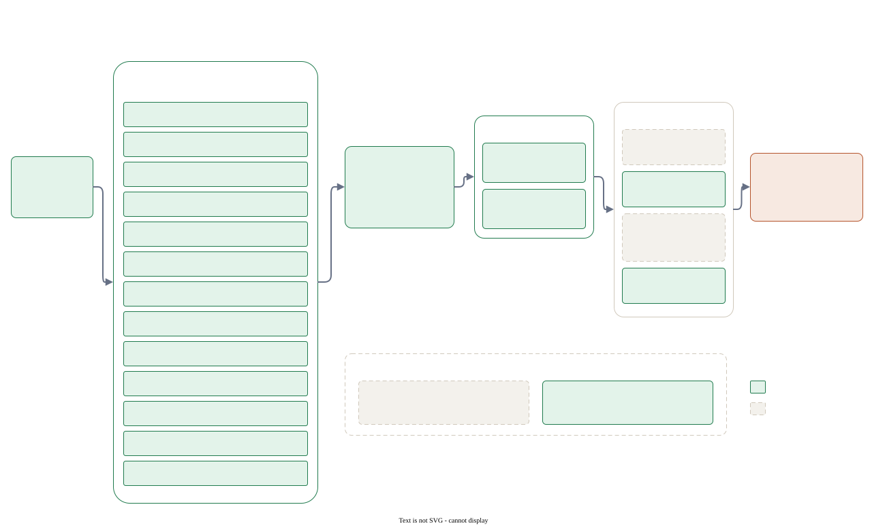
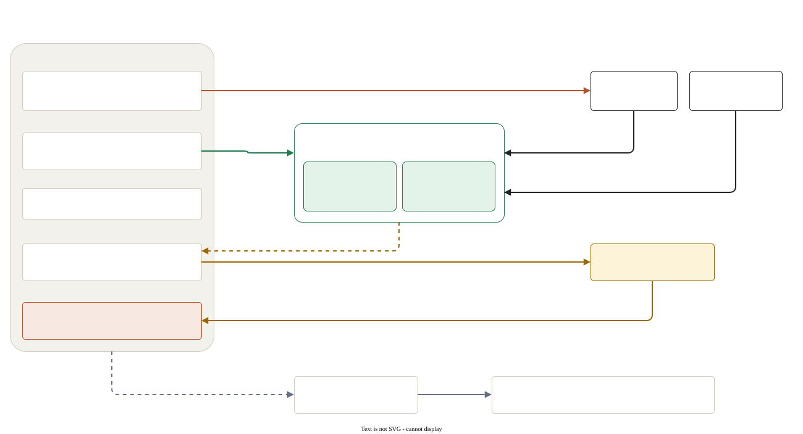

## この教材は何か

Anthropic と xAI が今推奨している、AI エージェントとの開発のやり方を、手を動かして身につける教材です。vimtutor のように、読みながら手元のファイルを直していき、`npm run check` で合否を確かめます。

| トラック | 内容 |
|---|---|
| A Claude Code 単体 | 公式「Claude Code 101」の順に、基本から並列・クラウド・MCP まで（A1〜A9）。セキュリティ・セッション・設定の診断・推奨の変化の追い方（A10〜A13） |
| B pstack | 公式推奨と比べて、どこが同じでどこが違うか（B1） |
| C 環境 | 1つのリポジトリを複数のエージェントで使う準備（C1）、ローカルとクラウドの使い分け（C2） |
| D Grok | Grok Build と Grok Bot（D02 が収録済み）。Claude Duet の観察メモ（D09） |
| E・F | LLM アプリの作り方（E、これから）。プロンプトの書き方と context の設計（F1・F2） |

[](../assets/diagrams/roadmap.svg)

## 「いつの時点の推奨か」を必ず見る

AI 開発ツールの推奨は数か月で変わります。たとえば 2025 年 3 月には「think harder と書くと深く考える」が推奨でしたが、今は `ultrathink` 以外の言葉は効かず、effort の設定が主な調整手段です。

そこで各章には次の3つを付けています。

- 本文の上の帯: 何年何月何日に、どのバージョンで確かめた推奨か（`as_of` と `applies_to`）
- 本文の横: 公式の告知。X の投稿や公式ブログで、その章の内容に触れたもの。原文を直接確かめられなかったものには「未確認」の札が付きます
- 章末: 推奨の年表。バージョンごとに何が推奨され、今も有効か（継続・置換・実験）

`npm run check` は、手元の `claude --version` が教材のバージョンより新しいと「推奨が変わっている可能性があります」と知らせます。そのときは帯にある公式ページを開いて、差分を確かめてください。

## 始める前に（教材の準備）

必要なものは git、Node.js 20 以上、python3（ビューアを使う場合）、Claude Code です。Claude Code のインストールとログインは [A1](#/a01-start) にまとめています。

教材のリポジトリを手元に置いて、そのフォルダで作業します。

```bash
git clone https://github.com/stland6338/ai-dev-tutor.git
cd ai-dev-tutor
```

教材の課題を動かすだけなら、追加のパッケージは要りません（依存パッケージなし）。`npm install` が入れるのは公開用の wrangler だけなので、省いて構いません。準備ができたら、下の「1. workspace を作る」の `npm start` に進みます。

## 進め方

[](../assets/diagrams/how-it-works.svg)

1. workspace を作る

   Claude Code が教材の CLAUDE.md を読まないように、workspace は教材フォルダの外に作ります。

   ```bash
   npm start
   ```

   既定の場所は `~/ai-dev-tutor-workspace` です。変えたいときは `TUTOR_WORKSPACE=~/somewhere npm start` のように指定し、`npm run check` にも同じ変数を付けます。

2. ビューアを開く（任意）

   ```bash
   npm run serve
   ```

   http://localhost:3250 を開きます。このファイルをエディタで直接読んでも構いません。

3. 各章の課題を workspace で行い、判定する

   ```bash
   npm run check
   npm run check -- --lesson a03   # 1章だけ
   ```

4. 機械で判定できない課題（manual）は、終えたら自分で完了にする

   ```bash
   npm run done -- a01-powerup
   ```

課題は自分で書いても、Claude Code に頼んでも構いません。**Claude Code に頼むこと自体が演習**です。ただし頼んだ場合も、結果を自分の目で確かめてから次へ進んでください。

## 最初の課題

<!-- exercise id="00-ready" check="file-contains" path="notes/00-intro.md" pattern="^準備OK: \[x\]" -->
workspace の `notes/00-intro.md` を開き、`準備OK: [ ]` を `準備OK: [x]` に書き換える。
<!-- /exercise -->

<!-- exercise id="00-path" check="file-contains" path="notes/00-intro.md" pattern="^workspace の場所: \S+" -->
同じファイルの `workspace の場所:` の後ろに、workspace の絶対パスを書く。
<!-- /exercise -->

書けたら `npm run check -- --lesson 00` を実行し、2つとも ✓ になることを確かめます。

## 2026-10 の公式発信の追い方

2026 年 9 月末から、Claude Code の開発者向けの記事は claude.dev のブログにまとまっています [V]。X では `@ClaudeDevs` が Claude Code と API の更新を、`@claudeai` が製品全体の告知を出しています。各章の「公式の告知」も、この2つのアカウントと claude.dev の記事を主な出典にしています。

この版で反映した主な発信は次のとおりです（詳しくは各章）。

| 日付 | 発信 | 反映した章 |
|---|---|---|
| 09-25 | Using Claude Code: Spending your effort | A1・A2 |
| 10-01 | Claude Code mods | A5・A6 |
| 10-06 | Claude Code in the cloud（cloud sessions の現場ガイド） | A7・A8 |
| 10-07 | Haiku 5.5 を Claude Code で提供 | A1・A5 |
| 10-14 | デスクトップアプリで多数のセッションを並べやすくした | A7 |
| 10-15 | How the Claude Code team does code review / Code Review の一般提供 | A3・A4・A7・A8 |
| 10-22 | subagent を main loop に畳む記事 / Agent Skills の寄贈 / Claude アプリの auto mode 既定化 | A5・A6 |
