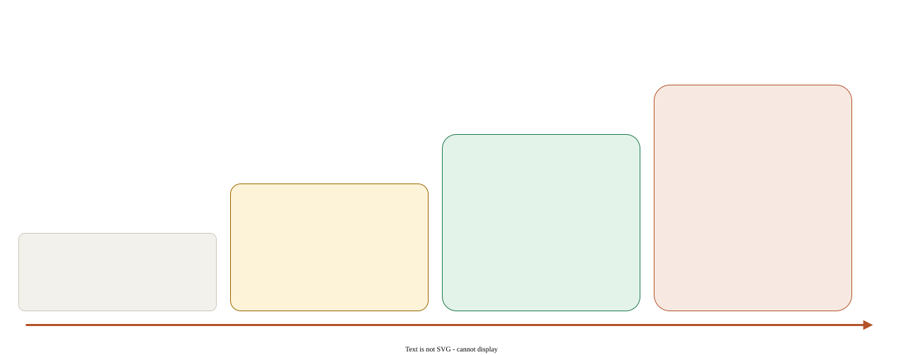

## この章でできるようになること

- 公式が「最も効く」とする「確かめ方を渡す」を、4つの強さで使い分けられる
- 再現テストを先に書かせてからバグを直させられる
- `/goal` と Stop hook で、テストが通るまで Claude に作業を続けさせられる

## 公式の要点

2026-10 時点の best-practices は、先頭に「Claude が自分の作業を確かめられる手段を渡す」を置いています [V]。テスト・ビルドの終了コード・スクリーンショットなど、合否が機械的に出るものです。

確かめ方を強制する方法は、弱い順に4段階あります [V]。

[](../assets/diagrams/a03-verify-ladder.svg)

| 強さ | 方法 | 特徴 |
|---|---|---|
| 1 | プロンプトに書く（「終える前に npm test を実行して」） | 手軽。忘れられることがある |
| 2 | `/goal <条件>` | ターンごとに小さなモデルが条件を確かめ、満たすまで続けさせる。`/goal clear` で解除 |
| 3 | Stop hook | 終わろうとするたびにスクリプトが走る。決定的（必ず実行される） |
| 4 | 検証用の subagent / `/code-review` | 別の context で、書いた本人以外が確かめる |

### Stop hook の仕組み

hooks のページに書かれている動きです [V]。

- Claude が応答を終えようとすると実行される。終了コード 2 か `{"decision": "block", "reason": "..."}` を返すと、Claude は止まらずに続ける（stderr か reason が理由として渡る）
- 入力の JSON に `stop_hook_active` がある。hook によってすでに続行中なら true になる。これを見ずに毎回止めると、満たせない条件で回り続ける（連続8回で打ち切られる）

## ハンズオン: 再現テスト → 修正 → 強制

`sample-app/ISSUE.md` のバグ（今日が期限のタスクが期限切れに出る）を直します。

### 1. 再現テストを先に書かせる

```text
ISSUE.md のバグを再現するテストを test/overdue.test.js に書いて。
まだ src は直さないで。テストが落ちることを npm test で見せて。
```

<!-- exercise id="a03-repro" check="file-contains" path="sample-app/test/overdue.test.js" pattern="overdue\(" -->
`test/overdue.test.js` に、`overdue` の再現テストを書かせる。直す前に落ちることを自分の目で確かめる。
<!-- /exercise -->

### 2. テストが落ちていたら Stop hook で差し戻す

`sample-app/.claude/hooks/require-tests.sh` を作ります。Claude に頼んで作らせても構いません。

```sh
#!/bin/sh
# Stop hook: テストが落ちていたら、Claude を一度だけ差し戻す
# hook による続行中（stop_hook_active が true）は止めない。止め続けると、満たせない条件で回り続けるため
active=$(node -e 'let s="";process.stdin.on("data",d=>s+=d).on("end",()=>console.log(JSON.parse(s).stop_hook_active===true))')
[ "$active" = "true" ] && exit 0
cd "$CLAUDE_PROJECT_DIR" || exit 0
if ! out=$(npm test --silent 2>&1); then
  echo "npm test が失敗しています。直してから終えてください:" >&2
  printf '%s\n' "$out" | tail -20 >&2
  exit 2
fi
```

- 文字列の grep だと Claude の最後の応答に同じ文字列が入っていたときに誤判定するので、入力の JSON は node で読みます
- 失敗したテストの出力の末尾を stderr に出すと、Claude はそれを理由として受け取り、何が落ちたかが分かります
- この作りでは差し戻しは一度だけです。ループを防ぐ代わりに、2回目の停止は通します。直りきるまで続けさせたいときは、次の `/goal` と組み合わせます

```bash
chmod +x .claude/hooks/require-tests.sh
```

`sample-app/.claude/settings.json` に登録します。

```json
{
  "hooks": {
    "Stop": [
      { "hooks": [ { "type": "command", "command": "\"$CLAUDE_PROJECT_DIR\"/.claude/hooks/require-tests.sh" } ] }
    ]
  }
}
```

<!-- exercise id="a03-stop-script" check="command" cwd="sample-app" run="test -x .claude/hooks/require-tests.sh && grep -q stop_hook_active .claude/hooks/require-tests.sh" -->
Stop hook のスクリプトを作る。実行ビットが無いと hook はエラーになるだけで止める働きをしないので、`chmod +x` で実行できるようにする。`stop_hook_active` を見て無限に回らないようにすること。
<!-- /exercise -->

<!-- exercise id="a03-stop-hook" check="json-has" path="sample-app/.claude/settings.json" key="hooks.Stop" -->
`.claude/settings.json` に Stop hook を登録する。Claude Code を起動し直し、`/hooks` で登録されたことを確かめる。
<!-- /exercise -->

### 3. /goal で直させる

まず `Shift+Tab` で auto mode にしておきます。`/goal` は権限モードを変えないので、Manual のままだと `npm test` のたびに確認が出ます [V]。

```text
/goal ISSUE.md のバグが直り、npm test が終了コード 0 で通る。test/ の期待値は変えない。20 ターンで止める
```

`/goal` は設定した時点で、その条件を指示として1ターン目を始めます。別に「直して」と頼む必要はありません [V]。ターンごとに小さなモデルが条件を判定し、満たすまで続けさせます。途中で終わろうとしても、テストが落ちていれば Stop hook も止めます。

条件の書き方（goal のページより）[V]:

- 判定役のモデルはコマンドを実行せず、ファイルも読みません。会話に出た出力だけで判定します。「npm test が終了コード 0」のように、Claude の出力で示せる形で書きます
- 終わりの状態を1つ、確かめ方、変えてはいけないもの、の3つを入れます
- 「20 ターンで止める」のような回数や時間の条項を入れると、走らせすぎを防げます
- `/goal` だけで状態を見られます。`/goal clear` で解除します

`/goal` の中身は、そのセッションだけの prompt 型 Stop hook です。Stop hook（強さ3）はスクリプトで決定的に判定し、`/goal`（強さ2）はモデルが判定します。

<!-- exercise id="a03-goal" check="manual" -->
`/goal` を設定した状態でバグを直させ、Claude が自分でテストを回して終える様子を見る。終えたら `npm run done -- a03-goal` で完了にする。
<!-- /exercise -->

<!-- exercise id="a03-fixed" check="command" cwd="sample-app" run="node --test test/overdue.test.js" -->
`test/overdue.test.js` が通る。テストを弱めて通すのは不正解。
<!-- /exercise -->

## 2026-10 の更新: 「終わった」ではなく出力を見せさせる

Claude Code チームのコードレビューの記事（2026-10-15）は、PR を出す前の第1層を次のように書いています [V]。

- テスト、ビルド、デザインと比べるスクリーンショットなど、Claude が実行できるものを渡し、「終わりました」と言わせるのではなく出力を見せさせる
- そのうえで、新しい context の subagent に diff をレビューさせる。どちらも best-practices にある習慣
- 同じ指摘が繰り返し出るなら、元を直す。skill、lint ルール、CLAUDE.md の更新のどれかにする

この記事は Boris Cherny の「確かめる手段を渡すのが最も大事で、最終結果が2〜3倍よくなる」という見積もりを引用しています。これまで「未確認」としていた @bcherny の tip は、公式ブログでの引用によって確かめられました。

レビューを回し続ける危険にも触れています [V]。書くエージェントとレビューするエージェントは互いに仕事を作り続けることがあり、一晩で50回以上往復した PR もあったそうです。チームは次のように変えました。

- 3回で打ち切り、それ以上は方針を見直すよう作者に促す
- 最初の数回のあとは、新しい diff だけを見直す
- 1行ではなく「バグの種類」を指摘し、同じ種類をまとめて直させる

A3 の Stop hook で差し戻しを一度に限ったのも、同じ理由です。

<!-- exercise id="a03-evidence" check="file-contains" path="notes/a03-verify.md" pattern="^見せてほしい出力: .{8,}" -->
`notes/a03-verify.md` に `見せてほしい出力:` の行を作り、ISSUE.md のバグが直ったと判断するために Claude に見せてほしい出力（コマンドと期待する結果）を書く。
<!-- /exercise -->

## 振り返り

- 強さ1（プロンプト）と強さ3（hook）の違いは「Claude の注意に頼るかどうか」です。何度も同じことを頼んでいるなら、hook にする合図です（pstack の encode-lessons-in-structure と同じ考え。B1 で比べます）
- 次の A4 では毎回伝えたいことを CLAUDE.md に、条件付きのことを rules に分けます
